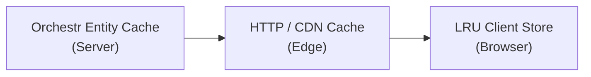
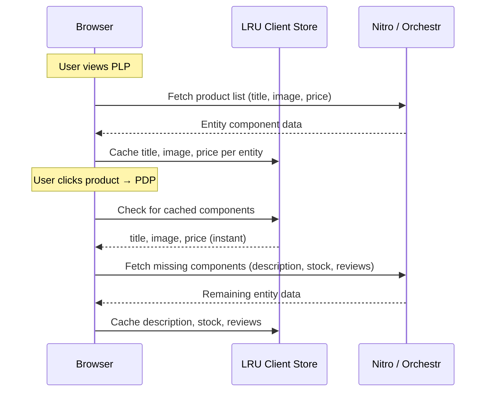

The Laioutr frontend is a Nuxt 3 app with **SSR enabled by default** and **no HTTP caching configured out of the box**. The server renders HTML for every request, hydrates on the client, and you opt in to CDN caching by adding route rules.

---

## Caching pipeline overview

Data passes through **three caching layers** before reaching the user:



| Layer                     | Where                     | What it caches                                                  | Configured via                                                                                      |
| ------------------------- | ------------------------- | --------------------------------------------------------------- | --------------------------------------------------------------------------------------------------- |
| **Orchestr Entity Cache** | Nitro server (in-process) | Query, link, and component resolver results at the entity level | Per-handler `strategy`, `ttl`, `buildCacheKey` (see [Orchestr Caching](/frontend/orchestr/caching)) |
| **HTTP / CDN Cache**      | CDN edge or reverse proxy | Full HTML responses and API JSON responses                      | `Cache-Control` headers via `routeRules` or middleware                                              |
| **LRU Client Store**      | Browser (Pinia-backed)    | Entity component data already loaded during the session         | Automatic; no configuration needed                                                                  |

::note
Orchestr's cache operates at the **entity component level**, not at the HTTP request level. Two different pages referencing the same product entity share cached component data on the server. This is separate from Nuxt's built-in `useFetch` / `useAsyncData` caching.
::

---

## Actions and SSR

When you call a server action via **useFetchAction**, the action runs **once on the server** during SSR and the result is **transferred to the client** via the serialized payload. The action does not re-execute on client hydration.

---

## Enabling CDN caching

To have a CDN cache SSR responses, send **Cache-Control** headers via **route rules**. A typical starting point:

```ts
// nuxt.config.ts
export default defineNuxtConfig({
  routeRules: {
    // Default: short CDN TTL for HTML, no browser cache
    '/**': {
      headers: { 'Cache-Control': 'public, max-age=0, s-maxage=15, must-revalidate' },
    },
    // Don't cache session-specific pages
    '/checkout/**': { headers: { 'Cache-Control': 'private, no-store, no-cache' } },
    '/cart': { headers: { 'Cache-Control': 'private, no-store, no-cache' } },
    '/login': { headers: { 'Cache-Control': 'private, no-store, no-cache' } },
  },
});
```

::tip
You can also define the same rules under `nitro.routeRules` if you prefer to keep Nitro config separate. The behaviour is identical.
::

**TTL guidance:**

- **HTML** — keep TTL short (15-60 seconds) so new deploys propagate quickly and users don't get stale asset references.
- **Static assets** (JS, CSS, images) — long TTL (1 year) with cache-busting filenames; Nuxt handles this automatically.

### Caching API responses

API routes (`/api/orchestr/...` or your own server routes) can also be cached by the CDN. Add `routeRules` for those paths with an appropriate `Cache-Control` header. Do not cache mutation endpoints or routes that return user-specific data.

### Overriding from a module

In your module's setup, extend `nuxt.options.routeRules` to add cache rules for routes your module registers. Merge with existing rules rather than overwriting the whole object so other modules' rules are preserved.

### Edge caching on Laioutr Cloud

Laioutr Cloud serves every storefront through Cloudflare's edge, on its assigned hostnames and on a custom domain alike. The edge stores a response only when the response's own headers allow it, and it keeps a separate copy per hostname, path and query string.

| Request or response | What the edge does |
| --- | --- |
| No cache header | Not stored. Images, fonts and PDFs from `public/` are the exception: the edge keeps them for a day. |
| `s-maxage`, or `max-age` without `s-maxage` | Stored for that many seconds. |
| `stale-while-revalidate=<seconds>` | After the lifetime ends, the edge serves the stored copy for that many seconds more and refreshes it in the background. This needs a number, and the header must not contain `s-maxage` or `must-revalidate`. Otherwise the next visitor waits for the refresh. |
| An `isr` route rule | Stored for the rule's lifetime, then refreshed in the background. See [`isr` rules on Laioutr Cloud](#isr-rules-on-laioutr-cloud). |
| `private` or `no-store` | Not stored. |
| `Set-Cookie` in the response | Not stored. The cookie reaches the visitor. |
| `Authorization` in the request | The edge neither serves a stored copy nor stores the answer. |
| A path under `/api/laioutr/` or `/api/public/` | Never stored, whatever the header says. |
| `Vary` | See [Using `Vary` headers](#using-vary-headers). |
| Query string | Part of the key, including `utm_*` parameters and click ids such as `gclid`. A link with tracking parameters fills a copy of its own, so its first request reaches your storefront. |
| A promotion to production | Clears the edge cache of your production hostnames. |

### `isr` rules on Laioutr Cloud

An `isr` route rule caches the route at the edge, as it does on Vercel. Nitro does not store the page itself, so the page takes no space in the project's shared cache.

```ts [nuxt.config.ts]
export default defineNuxtConfig({
  routeRules: {
    '/**': { isr: 3600 },
    '/api/**': { isr: false },
  },
});
```

| `isr` value | What the edge does |
| --- | --- |
| Seconds, such as `3600` or `{ expiration: 3600 }` | Serves the stored copy for that many seconds. For 31 days after that, it still serves the stored copy at once and refreshes it in the background. Only a request after those 31 days waits for a new render. |
| `true`, `{}` or `{ expiration: false }` | Keeps the copy for up to a year. A promotion to production clears it on your production hostnames. |
| `false` or `0` | Nothing. The response's own headers decide, as the table above describes. |

Browsers receive `Cache-Control: public, max-age=0, must-revalidate`. They do not keep the page, so every visit gets the edge's current copy.

The edge stores responses with status 200, 301, 302, 307, 308, 404 and 410, the same list as Vercel. Under `isr: true`, a 404 also stays until the next promotion, as it stays until the next deployment on Vercel. The edge does not store a response when:

- the request method is not `GET` or `HEAD`, or the status is not in the list above. A server error is never stored.
- the `Cache-Control` contains `private`, `no-store` or `no-cache`, as the response to a preview link does.
- the handler sets its own `Cache-Control`. That header then decides, as the table above describes. A `Cache-Control` from the same route's `headers` rule is not the handler's own, and `isr` replaces it.
- the request comes from the Studio preview frame.
- the render calls `setResponseCachedDownstream(event, false)` to say that it answers one visitor (see [Orchestr Caching](/frontend/orchestr/caching)).
- the response sets a cookie, or the request carries `Authorization`.
- the handler throws an error, for example with `createError`.

`allowQuery` has no effect on Laioutr Cloud, and the build logs a warning for it. The edge keeps a copy per full query string, as the table above describes. The build also warns about an `isr` value it cannot read, and the edge does not cache that route.

::note
On Laioutr Cloud, `isr` alone is enough to cache a route. An `swr` or `cache` rule on the same route still applies: Nitro keeps its own copy in the shared cache, and the edge refreshes its copy from that one. A change can then take the two lifetimes together to appear.
::

---

## Multi-market and locale cache keys

If your frontend serves **multiple markets, languages, or domains**, the CDN must store separate cached entries for each variant. Without this, a German user could receive HTML cached from a French request.

Laioutr resolves the market and the language from the request's hostname and path prefix, and from nothing else. Laioutr Cloud and Vercel include both in every cache key, so separate markets need no further setup there.

### Locale-prefixed routes

When locales are part of the URL path (e.g. `/de/products/...`, `/fr/products/...`), the CDN naturally caches them as separate entries since the URL differs. You can still define per-locale route rules:

```ts
// nuxt.config.ts
export default defineNuxtConfig({
  routeRules: {
    '/de/**': {
      headers: { 'Cache-Control': 'public, max-age=0, s-maxage=60, must-revalidate' },
    },
    '/fr/**': {
      headers: { 'Cache-Control': 'public, max-age=0, s-maxage=60, must-revalidate' },
    },
  },
});
```

### Domain-based multi-market

When each market is served from a different domain (e.g. `shop.de`, `shop.fr`), Laioutr Cloud and Vercel keep a separate copy per hostname. Most other CDNs do the same. Verify this with your CDN provider, in particular when one distribution serves several domains: its cache key must include the host.

### Using `Vary` headers

A `Vary` header makes a CDN keep a separate copy for each value of the request headers it names. Use it only for a header that your render reads, and only when that header has few distinct values. Laioutr's own market resolution reads neither `Accept-Language` nor a custom header such as `X-Market`, so a `Vary` on them only splits the cache.

| `Vary` names | Laioutr Cloud | Vercel |
| --- | --- | --- |
| `Accept` | A copy per exact header value | Part of the cache key by default |
| `Accept-Encoding` | Cached as usual | Part of the cache key by default |
| `Cookie` or `*` | Not stored | Not stored |
| Any other header, such as `Accept-Language`, `User-Agent` or `X-Market` | A copy per exact header value. A request without the header gets its own copy, and `de` and `DE` are two copies. | A copy per value |

Each new value fills a copy of its own, so its first request reaches your storefront. A header with many values, such as `User-Agent`, therefore sends most requests to your storefront. Put such a difference into the URL, or render that part on the client as described in [Handling personalized and time-sensitive content](#handling-personalized-and-time-sensitive-content).

### Server-side caching with `swr` and `cache` rules

::since-version{version="0.75.1" packages="@laioutr-core/frontend-core" changelog="frontend"}
::

The rules above only send headers, and a CDN does the caching. An `swr` or `cache` route rule makes Nitro store the rendered page itself — on Laioutr Cloud in the project's shared cache — and its keys work differently:

- Nitro renders a cached route with **only the request headers listed in `cache.varies`**, and stores the page under its URL plus those headers. No other header reaches that render: not the cookies, not `Accept-Language`.
- `@laioutr-core/frontend-core` adds `host` and `x-forwarded-proto` to `varies` on every caching rule. Each market domain therefore gets its own stored page, and `useRequestURL()` keeps the `https` scheme behind a proxy.
- If your render reads another header, list it yourself. The `swr` shorthand cannot carry `varies`, so write the rule as a `cache` object.
- A preview link's render is stored too, under its own URL. See [Content preview](/frontend/features/content-preview).
- Send the same header in `Vary` as well. The rule's `Cache-Control` lets a CDN store the page too, and without `Vary` the CDN keeps one copy for every value.

```ts [nuxt.config.ts]
export default defineNuxtConfig({
  routeRules: {
    '/': {
      cache: { swr: true, maxAge: 60, varies: ['accept-language'] },
      headers: { Vary: 'Accept-Language' },
    },
  },
});
```

Every listed header becomes part of the key, so the cardinality warning above applies here as well: never list `cookie` or any other header that differs per visitor.

---

## Handling personalized and time-sensitive content

For CDN caching to work, the SSR HTML for a given URL (and locale/market) must be the same for every user. Move personalized or session-specific content to the client:

- Wrap personalized UI (cart count, wishlist, "Hello, {name}") in `<ClientOnly>` or guard it with `import.meta.client` / `onMounted`.
- Show a **skeleton placeholder** with matching dimensions to avoid layout shift.
- For **time-sensitive data** (stock levels, live prices), either shorten the TTL for those routes or fetch the data client-side after hydration so the cached HTML stays stable.

---

## LRU client-side store

The third caching layer lives in the browser. When Orchestr returns entity data during a page load, resolved **entity components** are stored in a **Pinia-backed LRU cache**.

### How it works

Consider a typical shopping flow. You browse a **product listing page** where each product card loads entity components (title, image, price). When you click through to a **product detail page**, the LRU store already has those components cached. They render immediately while the PDP fetches remaining components (description, stock, reviews).



**Key characteristics:**

- **Automatic** — no configuration needed.
- **Entity-component granularity** — cache key is entity identifier + component type. Pages sharing the same entity share cached data.
- **Session-scoped** — lives in browser memory, not persisted to storage.
- **LRU eviction** — bounded memory; least recently used entries are evicted first.

::tip
Design your sections to use the same canonical component types (e.g. `product-title`, `product-image`) across listing and detail pages to maximize cache hits.
::

---

## Entry script loading

The first page view downloads the storefront's JavaScript bundle and, by Nuxt's default, a set of
`prefetch` and `modulepreload` hints for the chunks around it. On a slow mobile connection those
hints compete with the hero image before the first paint. The `entryScript` block in the `config`
section of your project's `laioutrrc.json` controls both. Without it, the entry script stays where
Nuxt puts it and only the prefetch links and the entry's own preload leave the head. A faster first
paint is the opt-in below:

```json [laioutrrc.json]
{
  "config": {
    "entryScript": {
      "loading": "after-paint",
      "hints": "siblings"
    }
  }
}
```

| Setting | Values | Default | Effect |
|---|---|---|---|
| `loading` | `eager`, `after-paint` | `eager` | `eager` keeps the entry script in the head. `after-paint` removes it and requests it from a small inline script after the window `load` event, so its bytes stop competing with the largest image. |
| `hints` | `all`, `siblings`, `with-entry`, `none` | `siblings` | `siblings` drops the prefetch links and the entry's own preload but keeps the preloads for the chunks the entry imports, so those are still discovered while the page parses and interactivity does not move. `with-entry` (frontend-core 0.66.1 and later, only with `loading: "after-paint"`) takes those preloads out of the head too, and the inline script requests them together with the entry, so they stop competing with the first paint and are still in flight before the entry needs them. Under `eager` it acts as `siblings`. `none` drops every hint, so the imported chunks also stop competing with the first paint, but interactivity comes around a second later on a slow connection, because the entry then discovers those chunks itself. `all` keeps Nuxt's output. |

Measured on the reference storefront's homepage under mobile throttling, against Nuxt's own head:
`loading: "after-paint"` took the largest contentful paint from 4,018 to 3,226 ms with Time to
Interactive unchanged. `hints: "none"` with the script eager took 900 ms off the largest
contentful paint and added about 1.2 s to Time to Interactive.

With `loading: "after-paint"`, `hints: "with-entry"` measured on another storefront's homepage made
the first paint about 0.6 s earlier than `siblings`, and Vue hydrated at the same time. That holds
while the imported chunks are smaller than the entry, because they now download alongside it. A
project whose imported chunks outweigh its entry should measure before it switches.

The setting applies to production builds only. To restore Nuxt's own head without changing the
project file, set both environment variables `NUXT_PUBLIC_LAIOUTR_ENTRY_SCRIPT_LOADING=eager` and
`NUXT_PUBLIC_LAIOUTR_ENTRY_SCRIPT_HINTS=all` on the deployment. The resolved value is on the public
runtime config as `useRuntimeConfig().public.laioutr.entryScript`.

---

## Render config prefetching

Resting on or tabbing to a `<NuxtLink>` loads the target page's render config into the Nuxt payload. Opening that page then costs no request for the config at all, on a first visit as much as on a return.

The config is cacheable in its own right: its URL carries a hash of the project configuration, so both the CDN and the browser keep the response until an edit changes that hash.

`frontend-core:link:intent` fires on the same signal, so an app can warm its own work for the page a visitor is heading to. See [Hooks](/frontend/features/hooks).

---

## Quick reference

| What                        | Where                                             | Default                                            |
| --------------------------- | ------------------------------------------------- | -------------------------------------------------- |
| **SSR**                     | `nuxt.config.ts` → `ssr`                          | `true` (Nuxt default)                              |
| **HTML caching**            | `routeRules` → `headers['Cache-Control']`         | Not set                                            |
| **API response caching**    | `routeRules` for `/api/**` or per-handler headers | Not set                                            |
| **Multi-market cache keys** | Hostname or URL-based locale prefix               | Built in: hostname and path                        |
| **Orchestr data cache**     | Per-handler `strategy`, `ttl`, `buildCacheKey`    | See [Orchestr Caching](/frontend/orchestr/caching) |
| **Client store**            | Automatic LRU                                     | Always on                                          |
