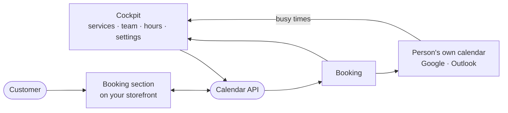

## Calendar

**Calendar** lets your customers book appointments on your storefront. They choose a service and a free time, and the booking arrives in the Cockpit at once — and in the calendar of the person who takes it. Calendar is an app: add it to an environment and it appears in that environment's menu with **Calendar**, **Bookings**, **Services**, **Team**, **Availability**, **Analytics** and **Settings**.

### How it fits together

Everything the storefront offers is decided in the Cockpit. The Booking section asks the calendar API for your services and free times and books through it; the API runs apart from the Cockpit, so booking on your storefront keeps working while the Cockpit is being deployed.

### Adding the app

Open **Apps** in the environment that should take bookings, find **Calendar** and click **Add**. You need the Developer or Owner role to add an app. Each environment has its own services, team, hours and bookings, so a test environment can be set up and tried without touching production.

### Services and categories

A **service** is what a customer books. Each one has:

- a name and a short description;
- a **duration** and, if you need one, a **break after** it;
- a **price** — free, fixed, or "from" a price;
- where it takes place — at your location, at the customer's, online or by phone;
- **who offers it**;
- whether a booking is **confirmed at once** or waits for you to accept it.

**Categories** group services on the storefront. A service you switch off is not offered there.

### Team and working hours

**Team** lists the people who can be booked. Each person follows your opening hours or has working hours of their own, offers the services you choose, and can take **time off**. The calendar sync column shows whether their own calendar is connected.

### Availability and public holidays

**Availability** sets the default opening hours of the week and the exceptions: closed days and changed hours. **Import public holidays** closes all public holidays of a country in one step. On a day nobody works, nothing can be booked — neither on the storefront nor by hand.

### Settings

One **Save** covers every tab, and a change applies at once.

| Tab | What it decides |
| --- | --- |
| General | Minimum notice, how far ahead customers can book, until when they may cancel, when an unanswered request expires, and whether the storefront shows who takes the appointment and fully booked days |
| Notifications | Which emails the customer and the team receive — confirmation, reminder, follow-up, cancellation and more — each with a template you can change |
| Calendar sync | Who has connected their calendar, invitations, a read-only calendar link per person, and which calendar providers are offered |
| Locations | The business address used for "at our location" |
| Booking form | Which standard fields are required, and questions of your own (**Add field**); the answers are kept with each booking |
| Privacy | The consent text and privacy link shown on the form, how long customer details are kept before they are anonymised, and **Find customer** to export or erase one customer's data |

### Calendar sync

Under **Settings → Calendar sync**, **Invite** a person to connect their own calendar. They receive an email and connect their Google or Microsoft account from it; only the invited address can accept. From then on:

- the Cockpit reads their **busy times** every few minutes — only busy or free, never the titles or details of private appointments — and those times are no longer offered for booking;
- every new booking is **added to their calendar** as an event, and removed again if it is cancelled.

**Disconnect** stops both and removes what was read. A person who prefers not to connect can subscribe to their **calendar link** instead: their confirmed bookings, read-only, in Apple Calendar or any calendar program.

::callout{type="info"}
Nobody enters keys or passwords of a calendar provider in a project. Each person signs in with their own account; the provider connection itself is set up once for the whole platform.
::

### The Booking section in Studio

The app brings a section called **Booking**. Open the page customers should book on in **Studio**, choose **Add Section**, search for **Booking** on the **General** tab and add it. The preview shows your real services straight away, in the style of your storefront.

| Group | Setting | What it does |
| --- | --- | --- |
| Content | Heading, Description | The text above the services |
| Content | Only this service | Offers one service alone instead of all of them |
| Layout | Presentation | **Dialog** — booking opens in a dialog over the services; **Inline** — the steps run on the page |
| Layout | Columns | One, two or three columns of services |
| Layout | Show duration, Show price | Whether each service shows them |

Colours and fonts follow your storefront's theme. Publish and deploy, and the section is live.

### What the customer sees

1. **Book** on a service.
2. A day and one of the free times. Only free times are offered: working hours, minus bookings, minus the busy times of a connected calendar, within the notice and the booking window from Settings.
3. Their details: the fields of your booking form, your own questions, the consent and the cancellation note, with a summary of the appointment.
4. The confirmation — **Booked**, or **Requested** for a service you confirm by hand. A confirmed appointment can be added to the customer's own calendar, as a calendar file or in Google Calendar, and a confirmation email is on its way.

If someone else took the time in the meantime, the customer is told and asked to choose another, so a time is never booked twice.

### Where a booking appears

- **Bookings** lists it with its status, service, person, customer and source — *Website* for a booking made on the storefront. Opening it shows every detail and the customer's answers; you can add an internal note or **Cancel booking**, which asks first and tells the customer.
- **Calendar** shows it in the week, next to the busy times read from the person's own calendar. Hours nobody works are shaded.
- **Analytics** counts bookings, utilization, cancellations and no-shows, per person and per source, over the last 30 days up to yesterday.

### Larry Copilot

Larry Copilot knows the calendar of the environment you are in. Ask how many bookings you have this week or how busy your team is, or tell him to close a day, import public holidays, add a category or change a setting. He shows every change first and makes it once you confirm. If the environment has no Calendar yet, he tells you how to get it.

### For developers

The Booking section talks to the calendar API on the storefront's server, never from the browser.

- **Address** — `https://api.laioutr.cloud/calendar/v1` by default. Change it with the app's `apiUrl` option or the environment variable `NUXT_LAIOUTR_CALENDAR_API_URL`, which wins at runtime.
- **Identity** — the storefront proves itself with the project's own slug and secret key and its environment's name, which it already has. A storefront needs no key of its own, and nothing about the calendar is configured in the project's settings.
- **Refusals** — a booking the API refuses comes back with the field it concerns, and the form shows the reason there: `name`, `email`, `phone`, `company`, `address`, `message`, `consent`, `fields`, `time`, `taken` (the time was booked in the meantime) or `service`. A question you added to the booking form is named `field:<key>`, with the key of that question.
- **Rate limits** — the API answers `429` with `Retry-After: 60` when one address sends far more requests than a storefront does, and when one environment receives a burst of bookings, so a bot cannot fill your calendar. Your storefront's normal traffic stays well below both.
- **Failing soft** — when the API cannot be reached or answers `429`, the section says booking is not available right now instead of breaking the page.
