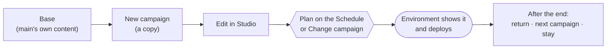

## Campaign Manager

A **campaign** is the whole Studio content of a storefront: its pages, global sections, header and footer, colours, fonts
and every setting typed in Studio. **Campaign Manager** keeps several campaigns per project, so you can build a Black Week
or Christmas look in Studio while visitors keep seeing the current one, and then put it live at the hour you choose.
Open **Campaign Manager** from the project sidebar, right after Studio.

Every environment shows exactly **one** campaign at a time, and Studio of an environment edits the campaign it shows.

### How it fits together

### The Library

**Campaign Manager → Library** has two parts.

- **On each environment now** — one card per environment with the campaign it shows. The `main` environment's own
  content is called **Base**; every other environment starts with its own content too.
- **All campaigns** — every campaign the project keeps, with search by name and description, the filters **On an
  environment or planned** and **Not used**, and a sort order. A campaign a plan will put on an environment says where
  and when.

Each campaign is drawn in its own colour — the same square in the Library, in Studio's campaign picker and on the
Schedule's bars.

**Details** opens a campaign's drawer: where it comes from, what it changes compared with that campaign (colours and
fonts, pages and global sections added, changed or removed), which environments show it, and its dates. Name and
description can be changed there, and a campaign nothing uses can be deleted.

#### Preview images

A campaign's card shows a picture of the campaign when it has one; otherwise it is drawn from the campaign's content —
its colours, fonts, the first heading of the home page and how many pages and global sections it has.

- **Set preview image** in the drawer uploads a picture of your choice. An uploaded picture always wins.
- **Taken from the live storefront**: once a campaign goes live on an environment and its deploy has finished, the
  Cockpit can take a screenshot of that environment's home page a minute later and use it as the picture. **Take from
  live storefront** in the drawer does the same at once for a campaign an environment shows now. This needs a
  screenshot service set up by the platform (Configuration → Campaign Manager); without it, uploaded pictures and the
  drawn card are used.

### Creating a campaign

**New campaign** copies any campaign — the Base, another campaign, or an older one — into a new one with a version number
of its own. Before you confirm, the dialog lists what is copied and what is shared:

| Copied into the new campaign | Shared by all campaigns |
| --- | --- |
| Pages and the order of their sections | CMS entries, and menus a section shows |
| Texts and settings typed into sections in Studio | Media |
| Header and footer made in Studio | Products and categories |
| Colours, fonts and tokens set in Studio | App settings |

Something that must be the same in every campaign — a legal text, contact details — belongs in a CMS entry, not in a
section.

The new campaign opens in Studio. Studio's top bar shows which campaign is open and lets you switch to another one; a
banner says when the open campaign is not the one the environment shows. Editing a campaign changes nothing on any
environment.

::callout{type="info"}
A project keeps a limited number of campaigns, shown on the Library. Delete campaigns you no longer need to make room.
::

### Putting a campaign live now

**Change campaign** — on an environment's card in the Library and on the **Environments** page — opens a dialog: pick a
campaign, read what the environment shows now and after you confirm, then confirm. The environment switches and is
deployed the same way **Publish** deploys it. If the deploy cannot start, nothing changes.

**Roll back** puts back what the environment showed before. It is offered only where there is something to return to.

Who may do this: whoever may deploy that environment. Everyone with access to Campaign Manager may look.

### Planning on the Schedule

**Campaign Manager → Schedule** shows, as a chart or as a list, which campaign each environment shows and which ones are
planned. Each bar names its campaign and its exact start and end; hover it for the full date and time. Times are in the
Cockpit's time zone, Europe/Berlin.

**Plan a campaign** asks for:

- **Campaign** and **Environment**;
- **Start** — now, or a date and time;
- **After the end** — **Return to what was before**, **Switch to another campaign**, or **No end** (the campaign stays
  until something else is put on);
- **End**, unless there is no end.

Before you confirm, the dialog shows what the environment shows until the start and what happens from the start and from
the end. Drag a bar to move a plan, or drag its right edge to change its end; each change asks you to confirm.

**Campaigns on one environment never overlap.** A plan that would overlap another is refused before it is saved, and the
message names the plan in the way. Two plans may follow each other back to back — Saturday's campaign ending as
Sunday's starts — and the environment then goes straight from the first to the second.

At its time the Cockpit switches the environment and deploys it. If a switch fails, it is tried again a few times and
the project's Owners are notified. A plan that has started keeps its start; you can still change its end. Deleting a
plan that has started rolls the environment back.

A plan belongs to the project, not to the person who made it: it runs at its time even if that person no longer has
access.

### Export and import

**Export** — in a campaign's drawer or on an environment's card — saves the campaign as a file. Before you save it, it
lists what is in the file (pages, global sections, the apps the storefront uses) and what is not: app settings, keys and
secrets, markets, languages, domains, redirects, CMS entries and products, and media files, which stay as addresses.

**Import campaign** in the Library's header reads such a file and always creates a new campaign, on no environment. The
preview shows what comes in, what will not resolve in this project (a market or language it lacks, media from another
host) and what is left out because this storefront cannot show it — a section it does not have, a setting no field
takes. What was left out stays listed in the imported campaign's drawer. A file with anything that could run code is
refused as a whole, and so is a file whose page paths do not start with a single `/` — a page always lives on the
storefront itself.

### Larry Copilot

Larry can manage campaigns for you from a question: list what each environment shows, create a campaign, rename,
delete, put one live, roll back, and plan, move or cancel a plan. Every change is shown as a card you confirm first, and
Larry can do only what you may do yourself — the same refusals apply, the overlap rule among them.

Larry does not design or edit a campaign's content. Asked to, he points you to Studio on that campaign.

### Access

| Role | Can |
| --- | --- |
| Content Manager and above | See the Library and the Schedule, create, rename, describe, delete, export and import campaigns, edit them in Studio |
| Whoever may deploy the environment | Change campaign, Roll back, plan, move and cancel plans on that environment |

Copying an environment's own content needs Studio on that environment.
