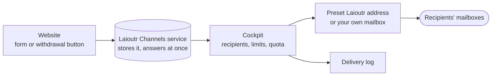

## Channels

**Channels** are the ways a project talks to its people and its visitors. Forms, the withdrawal button and apps such as the [Calendar](/cockpit/features/calendar) send through a channel, never through a connection of their own. So every message is in one delivery log, counted once, and protected by the same limits.

Open **Channels** from the **Project** section of the sidebar, beside **Environments** and **Domains**:

| Page | What it shows |
| --- | --- |
| **Overview** | What the delivery log adds up to: messages this month, the delivered rate, bounces and complaints, what waits, usage against the limit, and what needs attention |
| **Delivery log** | Every message, with its status and whether it counted, and what the website sent (**Received from the website**) |
| **All channels** | The channels of this project and whether each is connected |
| **Settings** | Messages waiting to be sent, the schedule that sends them, and how long the delivery log is kept |

[Open Channels in the Cockpit](https://cockpit.laioutr.cloud/o/_/p/_/channels)

### All channels

| Channel | Connection |
| --- | --- |
| Email | **Connected** where the [Essentials Mailer](/apps/essentials/mailer) app is installed in the environment, **Not set up** otherwise |
| SMS, WhatsApp, Push, Chat | **Planned**: not built yet, nothing to install, nothing sent |

A channel that is **Not set up** shows the app it needs and a button to add it. Until the app is installed, that channel sends nothing from the environment, and a product that sends through it says so on its own settings.

## The Email channel

The Email channel sends what your website and your apps email to your team and your visitors. It is on in every environment that has the **Essentials Mailer** app. Open it with **Open** on **All channels**, or directly at [Email](https://cockpit.laioutr.cloud/o/_/p/_/channel-email). Its tabs are **Overview**, **Recipients**, **Sender**, **Protection & privacy** and **Delivery log**.

The header has **Send a test email to me**: a test email goes to your own address with the settings in force. It is logged and never counts toward the project's emails.

### How a submission travels

1. A visitor submits a form or the withdrawal button. The storefront's Essentials Mailer posts it to Laioutr's Channels service.
2. The service checks that the request comes from your project, stores the submission and answers at once. The visitor reads that it was received.
3. The Cockpit takes it from there, usually within seconds and at most about a minute later. It checks the spam protection and the limits, applies the form's rule and the project's monthly quota, and sends the emails.
4. Every email goes into the delivery log. The submission itself appears under **Delivery log -> Received from the website** with how it ended.

Because the visitor is answered before the Cockpit sends anything, what happens at the monthly quota (held or not sent) is not shown on the website. The Owners are told instead.

Storefronts send this way from version 0.1.4 of the Essentials Mailer. Where the Channels service cannot take a submission, the Mailer falls back to the storefront's own SMTP server if one is configured: see [How a submission is delivered](/apps/essentials/mailer#how-a-submission-is-delivered).

The emails are written in German or English, in the visitor's language where it is one of the two, and in English otherwise.

### Recipients

A form goes to the first of these that has a confirmed address:

1. **Form rule**: addresses set for that form.
2. **Default recipients**: addresses that receive every form without a rule of its own.
3. **Organization Owners**: when nothing else is confirmed, so a form never ends up without a destination.

**Add email address** sends the new address a confirmation email. Forms are delivered there only after the click, so a form can never be used to send mail to any address. Until then the address shows **Awaiting confirmation**, and **Resend link** sends the email again. A rule's new addresses confirm the same way; until they do, that form goes to the default recipients.

#### Form rules

**Forms on the website** lists every form that has sent at least once. The withdrawal button is always listed. **Edit** opens the form's rule:

| Setting | What it does |
| --- | --- |
| Recipients | **Default recipients**, or **Own addresses for this form** (separated by commas) |
| Subject | Empty means the standard subject. `{form}`, `{name}` and `{order}` are filled in from the submission |
| Reply-to | **The address the visitor entered**, or **No reply-to address** |
| Acknowledgement to the visitor | A short confirmation that the message arrived, sent to the address the visitor entered. It repeats nothing the visitor typed |

For the withdrawal button, the consumer always receives the withdrawal confirmation. Only where the notice to your team goes, its subject and its reply-to can be changed.

### Sender

The Sender tab decides which address the emails come from. The recipients stay the same either way.

- **Sender name** and **Reply-to address** apply to every email. Without a reply-to address, answers to system emails go nowhere.
- **Preset Laioutr address**: created with the project, nothing to set up. Each project has an address of its own, `no-reply+<project id>@mail.laioutr.site`, with the project's name as the display name. Emails from it count toward the included emails.
- **Own mailbox (SMTP)**: your own address, through your mail server, with no monthly limit. Enter **Server**, **Port** (`587` with STARTTLS or `465` with TLS), **Encryption**, **Username**, **Password** and **From address**, then **Check and save**, or **Test and send a test email to me**. **Forget mailbox** goes back to the preset address.

With your own mailbox:

- Emails through it are never counted toward the included emails. The protection limits below still apply.
- If your server refuses an email, nothing is sent from Laioutr's address instead. The reason is shown in plain words on the Sender tab and in the delivery log, for example a refused login or a blocked port.
- Confirmation links to new recipients still come from the preset Laioutr address.
- Your domain must allow your mail server to send for it (SPF, DKIM, DMARC). Laioutr checks none of that; whether emails arrive is up to your mail provider.
- The password is stored sealed and never shown again. Leave the field empty to keep it.
- Mailbox checks are limited, by default to 10 an hour per environment.

### Protection & privacy

**Environments.** Stage and dev never reach real recipients. Every email from an environment other than the production `main` goes to the default recipients instead (or the Owners, where none is confirmed) and says so at the top. These emails are not counted. Only Laioutr support can switch this off.

**What protects the forms:**

| Check | What it does |
| --- | --- |
| Hidden trap field | On by default. Catches simple bots that fill in every field: such a submission is answered as received and nothing is sent |
| Submission limit | On by default. At most 5 submissions a minute from the same connection, where the website sends a client key |
| Invisible bot check | Off by default. Switched on, every submission without the check's token is refused. The Essentials Mailer does not send one yet, so keep it off until it does |
| Emails to visitors | By default at most 10 emails a day to one address a visitor typed, and 60 an hour to all visitors together. The license sets both, and they are always on |
| Notifications to the team | By default at most 120 form notifications an hour per environment. Withdrawals are not counted here |
| Report delivery failures | On by default. A bounced email, a spam complaint or an email the provider refused tells the Owners in the Cockpit and by email |

**Keep emails for resending.** By default no text of any email is stored. Then an email that fails, bounces or meets a limit cannot be sent again. An Owner can switch keeping on by accepting, on behalf of the organization, that it is responsible for the personal data in the emails kept. With keeping on, the text of every email this environment sends is kept for the period the platform sets (30 days unless shown otherwise on the page), then deleted for good. Meanwhile an email can be opened and resent from the delivery log. The confirmation link to a new recipient is never kept. If the accepted text changes, nothing more is kept until an Owner accepts the new version.

**Requests about one address.** When a person asks what this environment's messages hold about them, an Owner enters the address and chooses:

- **Export as JSON**: the log entries sent to it or about it, the kept texts, and website submissions it sent that still wait to be processed.
- **Erase...**: deletes the kept texts and waiting submissions, replaces the address with "erased" in the delivery log, and takes it off the default recipients and form rules. This cannot be undone.

Both are recorded in the audit log, without the address.

## What counts, and the monthly quota

Every project with the Essentials Mailer includes **200 emails a month**, sent from the preset Laioutr address. Only emails of the production environment are counted, and all of the project's counted emails share the 200. The month starts again on the 1st (German time).

| Counts | Never counts |
| --- | --- |
| Form notification to the team | Laioutr's own notices to the Owners (limits, bounces) |
| Acknowledgement to the visitor | Confirmation links to new recipients |
| Withdrawal notice and confirmation | Test emails |
| Emails from apps, such as the calendar's booking emails | Emails through your own mailbox |
| | Emails of stage and dev environments |

The Email channel's **Overview** shows **This month**: the emails used of the included ones, what waits to be sent, and when the month starts again.

**At the limit every counted email stops, withdrawals included.** Forms, acknowledgements, a withdrawal's notice and confirmation, and booking emails send nothing more until more volume is added or the month turns:

- Where the environment keeps emails for resending, they **wait** (status **Held**) and can be sent once there is room.
- Otherwise they are **not sent** at all (status **Skipped**), and the delivery log says so.

Sending emails the law requires, such as the confirmation of a withdrawal, is your business's responsibility. The Owners are told at **80 %** and at **100 %** of the included emails, with what stops and the way out.

**More volume** is a request to the Laioutr team: **Ask for more** on the Overview. No email packages are on sale yet, and nothing is charged.

## Delivery log

The log lists every message to your people and your visitors, through any channel and through the Cockpit's own mail. It is a record and is never edited. It is not an inbox: the messages themselves arrive in the recipients' mailboxes.

- **Messages**: time, channel, purpose, product, recipient, status and whether it counted. Filter by channel, status, product, sender and counted, or search by recipient or purpose.
- **Received from the website**: what the website sent through Channels, when it arrived, when it was processed, the form, and how it ended (for example **Sent**, **Held at the quota**, **Not sent at the quota**, **Caught by the trap**, **Too many**). A link opens the emails it made. What a visitor typed is cleared once it is processed.

| Status | Meaning |
| --- | --- |
| Queued | Waiting to be handed to the provider |
| Held | Waiting for room under a limit |
| Sent | Handed to the provider |
| Delivered | Accepted by the recipient's server |
| Accepted | Accepted by your own mail server, which reports nothing after that |
| Bounced | The recipient's server rejected it |
| Complained | The recipient marked it as spam |
| Failed | The provider or your mail server refused it |
| Skipped | Stopped at a limit and not sent |
| Unknown | Handed over more than a day ago, with no outcome since. It may have arrived |

Opening a message shows its delivery events. Where its text is kept, **Show text** opens it (each opening is recorded in the audit log) and **Resend** sends it again as a new entry, only while the address still receives these emails. A held email cannot be opened; it is only sent.

## Settings

**Waiting to be sent** lists kept messages that did not reach their recipients:

- **Send unsent**: messages never handed to the provider, held at a limit or not taken. They go within the license's limits.
- **Resend undelivered**: messages the provider took that then bounced or failed. They are never sent again by themselves, because one may have arrived after all.

**Send unsent messages automatically** sends unsent messages by themselves after 1, 2, 3, 5, 8, 12 or 24 hours. It is **Off** by default, and waits while keeping is off.

**How long the delivery log is kept**: 1, 3, 6 or 12 months, up to the period the platform sets (12 months unless the page says otherwise). Shortening the period deletes every older entry for good at the next daily cleanup.

## Notices to the Owners

The Owners receive these through the Cockpit's notifications:

- **Email not delivered**: an email bounced, was marked as spam or was refused. Never with the recipient's address.
- **Messages not sent at a limit**: the license had no room, so messages were held or not sent. Once per project, limit and period.
- **Messages not handed over**: a product could not hand a message to the channel at all, so it is not in the delivery log.
- **Website submissions not processed**: a form or withdrawal could not be processed after every try, so nobody received it.
- The 80 % and 100 % notices of the monthly quota.

## Who may do what

| Role | Can |
| --- | --- |
| Project Manager | Open Channels and the Email channel, change recipients, form rules and the sender, send test emails, open and resend kept emails, send unsent messages, and change the Channels settings |
| Owner | Everything above, switch keeping emails on by accepting the text, and export or erase one address |
| Laioutr support | Switch off the redirect of stage and dev |

## Larry Copilot

Larry Copilot reads the channels, the delivery log, the Overview and the quota of the environment you are in, and can send unsent messages or resend undelivered ones after you confirm. Email addresses are hidden from him because he runs on external models: open them on the page. Reading a kept email's text and requests about one address stay on the pages.
